# BMW Motor Sound MGU App

## Installationskorrektur 0.2.2 · 21. November 2026

**Für das Update im MGU Store den Zweig `codex/luxo-sound-tuning-020` auswählen.** Dort liegen das App-Paket 0.2.2 und der Audio-Dienst 0.2.2. Die Änderungen sind in [Pull Request #1](https://github.com/patryklars6/BMW-Motor-Sound-MGU-App/pull/1) einsehbar.

Version 0.2.2 behebt **`bad enable entry: nothing changed`**: Der Audio-Dienst aktiviert seinen Socket mit `{"unit":"luxo-motor-audio.socket","target":"sockets.target"}`. Die App fordert nun den Audio-Dienst **0.2.2 oder neuer** an. App-ID, Profile und Einstellungsstruktur bleiben erhalten. **35 Node-Tests, vier Python-Tests und zehn Prüfungen mit dem unveränderten Store-/Deployer-Code bestanden.** Der echte Deployer weist das alte Paket ab und akzeptiert die korrigierte Audio-Dienst-Vorprüfung. [Prüfbericht 0.2.2](docs/reparatur-0.2.2.md)

LUXO Motor Sound ergänzt BMW-MGU-Head-Units mit iDrive 7 um ein Motorsound-Menü und ein Dashboard für verfügbare Fahrzeugdaten. Die Bedienungsreparatur, das native BMW-Menü und die Audio-Diagnose bleiben in **0.2.2** enthalten. Der vollständige Installationslauf, systemd-Dienststart und die hörbare Ausgabe sind am Fahrzeug noch zu bestätigen. Die 14 LUXO-Aufnahmen unten stammen weiterhin aus Paket 0.2.1.

## Installation und Update über den MGU Store

1. Öffne im BMW den **MGU Store** und aktualisiere die bestehende Quelle `patryklars6/BMW-Motor-Sound-MGU-App`.
2. Wähle weiterhin den Branch **`codex/luxo-sound-tuning-020`**.
3. Öffne **LUXO Motor Sound**. Prüfe, dass der Store **0.2.2** anbietet, und wähle **Aktualisieren** beziehungsweise bei der noch fehlenden App **Installieren**. Die App-ID bleibt `patryklars6_motor_sound`. Der Store kann damit die vorhandene Installation zuordnen.
4. Der Store installiert als Abhängigkeit **LUXO Audio-Dienst 0.2.2** (`luxo-motor-audio`). Falls der Store die Dienste als ausstehend meldet, werden sie beim nächsten regulären Start der Head Unit aktiviert.
5. Öffne die App. Sie startet mit dem vollständig bedienbaren **BMW-Menü**. Profile, Tuning, Pegel, Verstärker, Fahrmodi, Design, Live-Daten und Hilfe sind dort per Touch und Controller erreichbar.
6. Der Menüpunkt **LUXO-Oberfläche** zeigt, ob ein kompatibler `mgu-render/1` mit Touch-Routing bereitsteht. Bei verfügbarer Unterstützung kannst du die LUXO-Grafik öffnen. Bei Renderer-Ausfall kehrt die App in das BMW-Menü zurück.

Die Einstellungen liegen weiterhin in `data/settings.json` der bisherigen App-Installation. Der Paketbau enthält keine neue Einstellungsdatei. Das Laden und Speichern der bisherigen Werte wurde automatisiert geprüft. Der vollständige Store-Updatevorgang auf der Fahrzeug-MGU steht zur Bestätigung aus.

Beim ersten Hinzufügen der Quelle verwende **Einstellungen → Quelle hinzufügen** bzw. **Settings → Add source**, gib den Repository-Namen ein und wähle den oben genannten Branch. Ein vorhandener Community-MGU-Store mit Python-Build-Unterstützung und Internetzugang wird vorausgesetzt. Die App ist für **iDrive 7** deklariert. [Paketformat des verwendeten Stores](https://github.com/robertnisipeanu/mgu-store/blob/main/docs/PUBLISHING.md)

### Audio zuerst prüfen

Öffne im BMW-Menü **Lautstärke und Audio**. Die Anzeige unterscheidet einen fehlenden Audio-Dienst, einen fehlenden ALSA-Mischpfad und eine bestehende PCM-Verbindung. Du kannst dort den App-Pegel und die Pegelgrenze ändern und die Verbindung erneut prüfen.

Für hörbaren Ton ist weiterhin ein auf deiner MGU bestätigter ALSA-Mischpfad `luxo_overlay` erforderlich. Der Dienst liefert den erzeugten PCM-Strom an diesen Pfad. Paralleler Betrieb mit Radio/CarPlay, akustisch unabhängige Lautstärke und Center-Ausgabe sind auf deinem Fahrzeug weiterhin offen. [Reparaturbericht mit Tests und Fahrzeugprüfung](docs/reparatur-0.2.1.md)

[ID7-Updatepaket 0.2.2](https://github.com/patryklars6/BMW-Motor-Sound-MGU-App/blob/codex/luxo-sound-tuning-020/packages/patryklars6_motor_sound@0.2.2.tgz) · [Audio-Dienst 0.2.2](https://github.com/patryklars6/BMW-Motor-Sound-MGU-App/blob/codex/luxo-sound-tuning-020/packages/luxo-motor-audio@0.2.2.tgz)

## Neue Menübilder · Version 0.2.1 · LUXO

Alle 14 Aufnahmen wurden neu aus dem gebauten **Paket 0.2.1** auf dem Entwicklungsrechner erzeugt. Sie zeigen die tatsächlichen Zeichenfunktionen der App im selben **LUXO**-Design: Dunkelgrau, Weiß und Violett. Es sind **keine Fahrzeugfotos**. Ohne Fahrzeugverbindung bleiben Live-Werte auf **Nicht verfügbar** und Audiokanäle auf **nicht bestätigt**. MATCH UP 10 ist als Soundsystem ausgewählt.

Die Bilder zeigen die optionale LUXO-Grafik. Die App startet zuerst im nativen BMW-Menü; dessen Darstellung wird von der Head Unit vorgegeben. Zum Öffnen der Grafik ist ein kompatibler Renderer mit Touch-Routing erforderlich. Eine Aufnahme des nativen Menüs im echten Fahrzeug steht aus. Aufnahmeverfahren und Bildprüfsummen stehen in [capture.json](docs/screenshots/0.2.1/capture.json).

### Hauptmenü

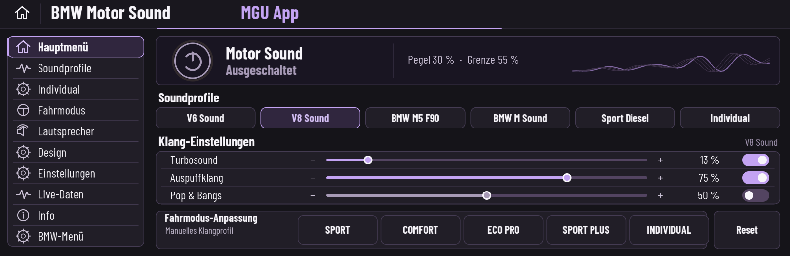

### Live-Daten

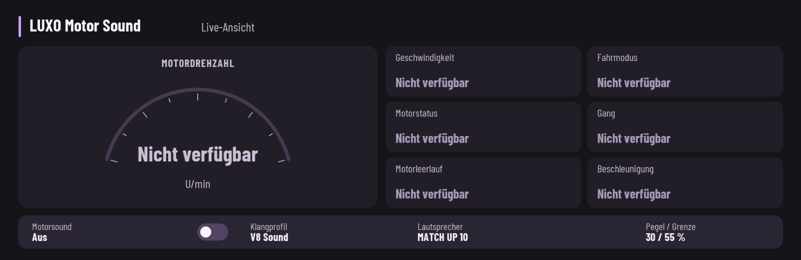

### Soundprofile

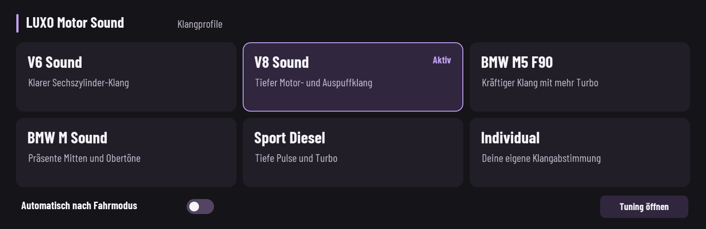

### Sound-Tuning

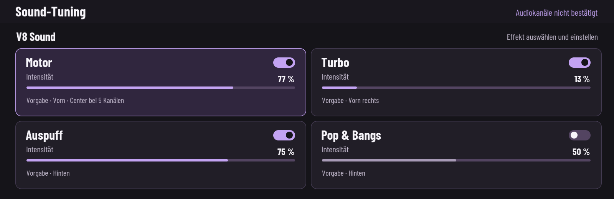

### Motor-Einstellungen

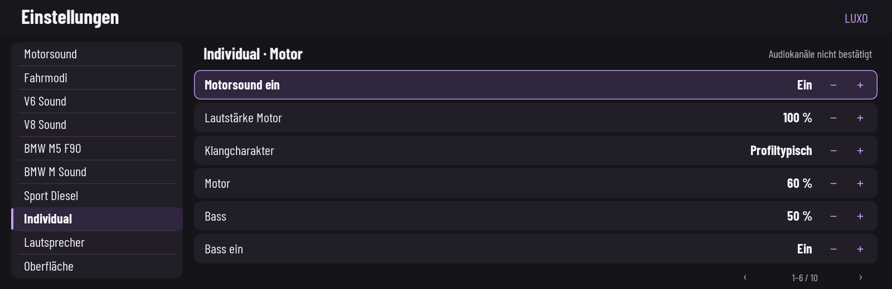

### Turbo-Einstellungen


### Turbo-Varianten und Verteilung

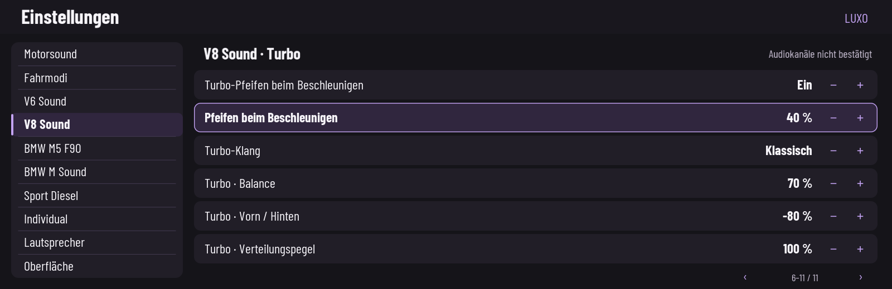

### Auspuff-Einstellungen


### Künstliche Pop & Bangs

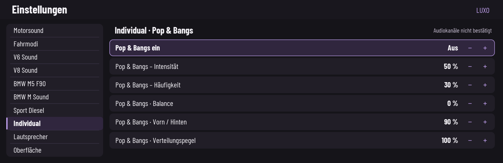

### Lautsprecher

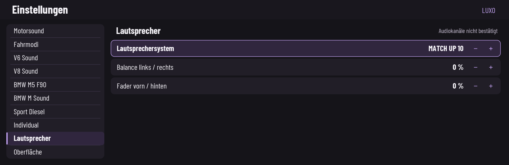

### Fahrmodi

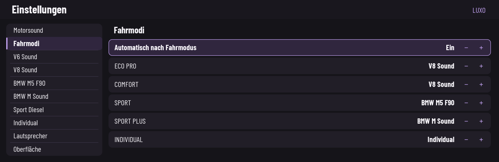

### Allgemeine Einstellungen

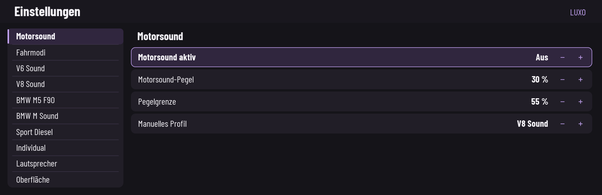

### Design

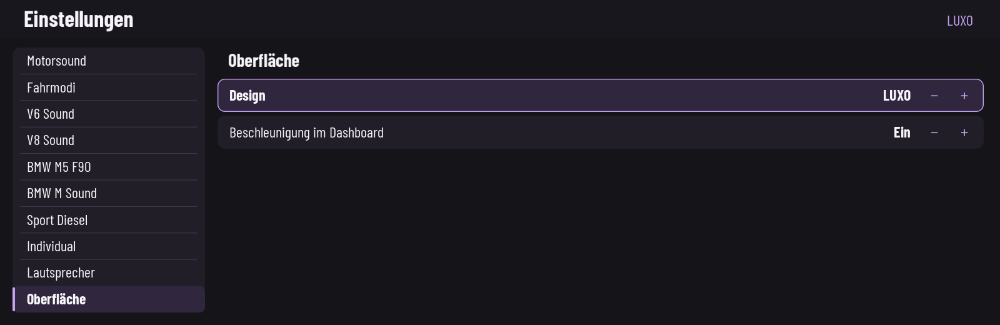

### Info und Hilfe

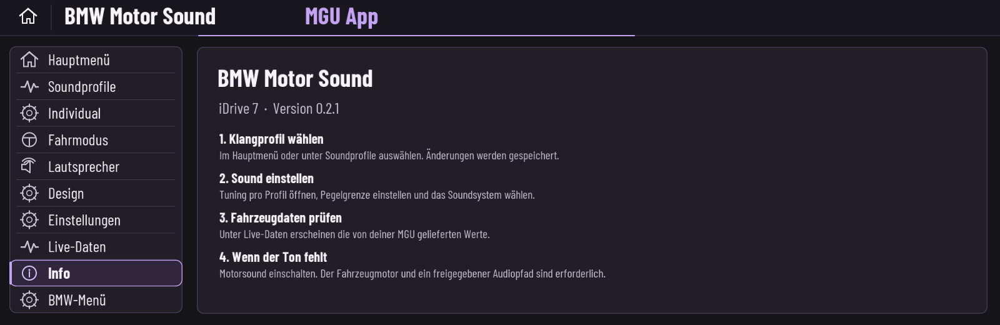

[ID7-Paket 0.2.2 herunterladen](https://github.com/patryklars6/BMW-Motor-Sound-MGU-App/blob/codex/luxo-sound-tuning-020/packages/patryklars6_motor_sound@0.2.2.tgz)

Im **Lautsprecher**-Menü stehen Standard, BMW HiFi, Harman Kardon, Bowers & Wilkins, MATCH UP 8, MATCH UP 10 und Sonstiges / Aftermarket zur Auswahl.

Im BMW-Menü öffnest du eine Zeile per Touch oder mit dem Controller. Wähle einen Regler und anschließend seinen Wert. **Weitere Einträge** und **Vorherige Seite** blättern durch längere Listen, **Zurück / Hauptmenü** führt eine Ebene zurück. Die LUXO-Karten und Direktregler sind bei bestätigtem Renderer-Touch verfügbar.

## Soundprofile und Regler

**V6 Sound**, **V8 Sound**, **BMW M5 F90**, **BMW M Sound**, **Sport Diesel** und **Individual** besitzen jeweils eigene Einstellungen. Öffne **Tuning** auf der Profilseite oder im Hauptmenü **Individual**. Die Karten **Motor**, **Turbo**, **Auspuff** und **Pop & Bangs** führen zu den jeweiligen Reglern. In den allgemeinen Einstellungen findest du alle Werte auch in der Kategorie des Profils. Bei **Individual** lässt sich zusätzlich der Grundklang wählen. Die App erzeugt die Klänge selbst.

| Regler | Wirkung |
| --- | --- |
| Motorsound, Turbosound, Auspuffklang | Schaltet die jeweilige Klangschicht ein oder aus. |
| Motor, Turbo, Auspuff | Stellt die Intensität der jeweiligen Schicht ein. |
| Lautstärke Motor, Turbo, Auspuff | Regelt den eigenen Pegel jeder Schicht unabhängig vom App-Gesamtpegel. |
| Bass und Klangtiefe | Aktiviert den Tieftonanteil und regelt dessen Stärke und Gewichtung im Motor-Klang. |
| Klangcharakter | Wählt Profiltypisch, Tief, Ausgewogen, Sportlich oder M Performance. Die Auswahl verändert Obertöne, Bass und Klangstruktur. |
| Turbo-Klang und Turbo-Pfeifen | Wählt Dezent, Klassisch, Hell oder Twin-Scroll. Für Beschleunigung und Gaswegnahme gibt es separate Schalter und Intensitäten. |
| Pop & Bangs | Spielt bei passender Drehzahl und erfasster Gaswegnahme kurze synthetische Impulse. Intensität und Häufigkeit lassen sich separat ändern. Die Funktion ist anfangs ausgeschaltet. |
| Pegel und Pegelgrenze | Bestimmt die Lautstärke der Motorsound-App und begrenzt ihren maximalen Ausgangspegel. |
| Profil-Balance und Profil-Fader | Verteilt die Klangschichten links/rechts und bei geeignetem Mehrkanal-Mischpfad vorn/hinten. `Lautsprechereinstellung` übernimmt die Vorgabe des Systems. |

Änderungen werden automatisch gespeichert. **Reset** im Hauptmenü setzt die Werte des dort angezeigten Klangprofils auf seine Vorgaben zurück. Die Wahl des Lautsprechersystems und das Design bleiben erhalten.

## Lautsprecher und Fahrmodi

Das Lautsprechermenü bietet angepasste Ausgangspegel und Basswerte. Bei **Sonstiges / Aftermarket** kannst du hintere Lautsprecher, Pegel und Bass selbst angeben. Die Auswahl wird gespeichert. Unter **Tuning** hat jeder Effekt eigene Balance-, Fader- und Verteilungspegel. Negative Balancewerte verschieben nach links, positive nach rechts. Ein negativer Faderwert verschiebt nach vorn, ein positiver nach hinten. Die Voreinstellung platziert Motor vorn, Turbo vorn rechts und Auspuff sowie Pop & Bangs hinten. Center-Anteil ist nur bei einem Fünfkanal-Mischpfad einstellbar. Stereo überträgt nur links/rechts. Die Anzeige im Tuning und Lautsprechermenü nennt die aktuell gemeldeten PCM-Kanäle.

Der App-Pegel und seine Obergrenze gelten ausschließlich für den PCM-Strom der App. Der große Schalter im Hauptmenü schaltet ihn sofort stumm. Profilwechsel und Pegelanpassungen werden geglättet. Ob Radio, Bluetooth oder CarPlay parallel laufen und ob der BMW-Lautstärkeregler hinter dem Mischpfad beide Quellen beeinflusst, hängt von der tatsächlichen Audioarchitektur ab. [Fahrzeugtest und Mischpfad](docs/fahrzeugtest.md)

Aktiviere unter **Fahrmodus** die Automatik und wähle pro Modus ein Profil für **ECO PRO**, **COMFORT**, **SPORT**, **SPORT PLUS** und **INDIVIDUAL**. Die Zuordnung folgt dem gemeldeten BMW-Modus. Einzelne Individual-Varianten verwenden dieselbe Individual-Zuordnung. Du kannst die Automatik im Hauptmenü abschalten oder ein Profil direkt auswählen.

## Design und Dashboard

Unter **Design** wählst du **LUXO**, **M-Performance**, **Orange Sport** oder **Ice White**. Orange Sport entspricht der orangefarbenen Hauptmenü-Vorlage. Die Auswahl gilt für Hauptmenü, Live-Daten, Profile, Einstellungen und Hilfe und wird gespeichert. Ebenfalls dort kannst du die Beschleunigung im Dashboard ausblenden.

Die Drehzahlzahl zeigt den letzten real empfangenen, gerundeten Messwert. Nur der Drehzahlbogen wird zwischen empfangenen Messpunkten animiert. Mit einem kompatiblen GPU-Renderer kann die Darstellung bis zu 60 Bilder pro Sekunde erreichen. Die BMW-Menüzeilen aktualisieren sich etwa alle halbe Sekunde. Die Messrate hängt von der Head Unit ab.

## Fehlerbehebung und Fahrzeugtest

| Anzeige | Prüfung |
| --- | --- |
| Nicht verfügbar | Unter Live-Daten prüfen, ob die MGU das betroffene Signal liefert. Fehlende und ungültige Werte werden als solche angezeigt. |
| Wartet auf Fahrzeugdaten | Motorstatus und Drehzahl in der Live-Ansicht prüfen. Bei unbekanntem oder veraltetem Drehzahlsignal bleibt der Sound stumm. |
| Wartet auf Fahrmodus | Prüfen, ob der BMW einen unterstützten Modus liefert. Alternativ ein Klangprofil manuell wählen. |
| Audiopfad nicht verfügbar | Für den Motorsound ist eine auf der konkreten MGU bestätigte parallele Mischroute erforderlich. Die App beansprucht keine Medienquelle. |
| Stumm | App-Pegel, Pegelgrenze und Schalter der Klangschichten prüfen. |

Version 0.2.0 wurde im BMW G31 530d mit MATCH UP 10 gestartet. Der Nutzer meldete bei 0.2.1 den Audio-Dienst-Installationsfehler. Die Installationsvorprüfung des Audio-Dienstes besteht mit 0.2.2 auf dem Entwicklungsrechner; der vollständige Fahrzeuglauf steht aus. Die gleichzeitige Wiedergabe mit Radio, Bluetooth und CarPlay ist auf der Serien-MGU bisher nicht bestätigt. Auch Autostart, Hintergrundbetrieb, tatsächlich verfügbare Fahrzeugfelder und physische Kanalzuordnung brauchen einen Fahrzeugtest. Der [Fahrzeugtestplan](docs/fahrzeugtest.md) beschreibt die Prüfung und den Audio-Dienst.

## Paket bauen und testen

Wechsle für den Paketbau und die Tests in den Installationszweig mit Version 0.2.2:

```sh
git switch codex/luxo-sound-tuning-020
python tests/run_checks.py
```

Der Paketbau nutzt Python 3 und das mitgelieferte iDrive-App-Kit. Die Hosttests nutzen Node.js ab Version 20. Die App-Laufzeit zielt auf die Node.js-8-Umgebung des iDrive 7. [Herkunft des App-Kits](vendor/README.md)

Die Prüfung lädt beim ersten Lauf vier unveränderte Dateien aus dem in `tests/store_upstream.json` festgelegten MGU-Store-Commit und verifiziert deren Git-Blob-Prüfsummen. Danach nutzt sie den Cache unter `dist/`. Mit `--store-source /pfad/zum/mgu-store` kann ein vorhandener Checkout dieses Commits verwendet werden. Der Audio-Dienst wird mit dem echten Store-Packer gebaut und durch `check --artifact` sowie `preflightApp` des echten Deployers geprüft. Die Hardwarepfade liegen dabei in einem isolierten Testverzeichnis; es wird kein Fahrzeug und kein systemd-Dienst gestartet.
