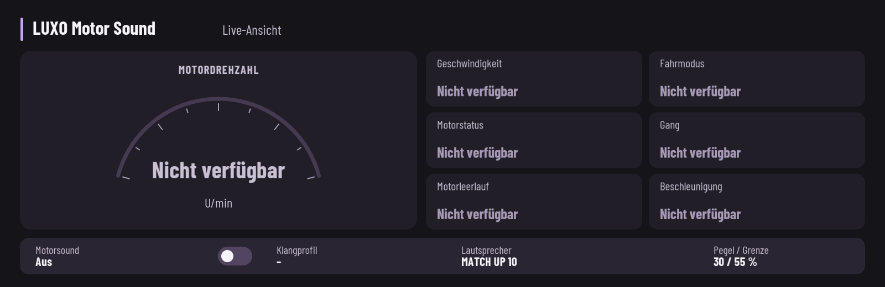
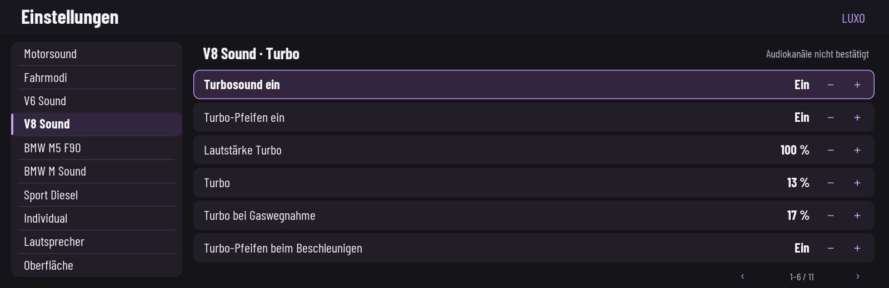

# BMW Motor Sound MGU App

**LUXO Motor Sound** für BMW MGU mit iDrive 7. Die App zeigt reale Fahrzeugdaten über die lesenden SOME/IP-Schnittstellen der Head Unit an und erzeugt daraus einen separat regelbaren Motorsound. Version **0.1.1** ist für den Fahrzeugtest vorbereitet.

## Installation über den MGU Store

Diese Anleitung gilt für den Community-MGU-Store auf BMW-MGU-Head-Units mit **iDrive 7**. Sie setzt voraus, dass der MGU Store bereits installiert ist, sich öffnen lässt und Internetzugang hat. [Dokumentation zum MGU Store](https://github.com/robertnisipeanu/mgu-store#readme)

### 1. GitHub-Quelle hinzufügen

1. Öffne den **MGU Store** in deinem BMW.
2. Wähle **Einstellungen → Quelle hinzufügen**. Bei englischer Sprache steht dort **Settings → Add source**.
3. Gib den Namen des öffentlichen GitHub-Projekts ein.

   ```text
   patryklars6/BMW-Motor-Sound-MGU-App
   ```

4. Wähle in der angezeigten Kanalauswahl den passenden Branch.

   | Welche Version möchtest du installieren? | Branch im MGU Store |
   | --- | --- |
   | **0.2.0** mit der neuen LUXO-Oberfläche, sechs Klangprofilen und Sound-Tuning | `codex/luxo-sound-tuning-020` |
   | **0.1.1** vom Hauptbranch, solange die Testversion im Pull Request liegt | `main` |

   Die Version 0.2.0 liegt in [Pull Request #1](https://github.com/patryklars6/BMW-Motor-Sound-MGU-App/pull/1). Für öffentliche GitHub-Quellen ist normalerweise keine GitHub-Anmeldung nötig.

### 2. App installieren

1. Lass den Store die gewählte Quelle laden. Aktualisiere die Quelle im Store, falls die App noch nicht angezeigt wird.
2. Wähle **LUXO Motor Sound** und prüfe im Store, ob die gewünschte Versionsnummer angezeigt wird.
3. Wähle **Installieren** bzw. **Install**. Der Store lädt die Dateien aus dem gewählten Branch und baut die App auf deiner Head Unit. Wenn der Store einen weiteren Schritt anzeigt, folge seiner Meldung. [So verarbeitet der MGU Store einen GitHub-Branch](https://github.com/robertnisipeanu/mgu-store/blob/main/docs/PUBLISHING.md#3-repo-tree)
4. Öffne **LUXO Motor Sound** anschließend aus der iDrive-App-Liste. In Version 0.2.0 findest du die Versionsnummer auch unter **Info** im Hauptmenü.

### 3. Erster Start mit Version 0.2.0

1. Öffne **Live-Daten** und prüfe im Stand, ob Drehzahl und Motorstatus angezeigt werden. Fehlende Werte erscheinen als **Nicht verfügbar**.
2. Wähle unter **Lautsprecher** dein System, zum Beispiel **MATCH UP 10**, und unter **Soundprofile** den gewünschten Klang.
3. Stelle unter **Einstellungen → Motorsound** zuerst einen niedrigen Pegel und eine Obergrenze ein. Der Motorsound ist bei der ersten Einrichtung ausgeschaltet. Einschalten kannst du ihn über den großen Schalter im Hauptmenü.

Die Installation im Fahrzeug steht noch zur Prüfung aus. Für hörbaren Motorsound braucht die App zusätzlich einen bestätigten Audiomischpfad. Bis dahin kann die App **Audiopfad nicht verfügbar** anzeigen. [Fahrzeugtest und Audiopfad](docs/fahrzeugtest.md)

### Wenn du nicht weiterkommst

| Was siehst du? | Was kannst du prüfen? |
| --- | --- |
| Die Quelle lässt sich nicht laden | Prüfe den Internetzugang des Stores und die Schreibweise des Repository-Namens. |
| Die App erscheint als 0.1.1 | Prüfe den gewählten Branch. Für 0.2.0 verwende `codex/luxo-sound-tuning-020`. |
| Der Store meldet einen Paketbaufehler | Prüfe die Detailmeldung im Store. Für diesen Branch benötigt der Store seinen Python-Build-Support `mgu-python`. |
| Die App öffnet sich, aber es kommt kein Ton | Prüfe den Motorsound-Schalter und die Meldung zum Audiopfad. |

## Menüs im LUXO-Design

Alle Bilder zeigen dieselbe Einstellung **LUXO** mit dunkelgrauem Hintergrund und violetten Akzenten. Die Vorschauen stammen aus dem ID7-Paket 0.2.0. In der Live-Ansicht fehlen Messwerte, weil bei der Aufnahme keine Fahrzeugverbindung bestand.

### Hauptmenü


### Live-Daten



### Soundprofile


### Sound-Tuning


### Turbo-Einstellungen



### Lautsprecher


### Fahrmodi


### Allgemeine Einstellungen


### Design


### Info und Hilfe


[ID7-Paket 0.1.1](packages/patryklars6_motor_sound@0.1.1.tgz) · [ID7-Paket 0.2.0 im Test-Branch](https://github.com/patryklars6/BMW-Motor-Sound-MGU-App/blob/codex/luxo-sound-tuning-020/packages/patryklars6_motor_sound@0.2.0.tgz)

## Funktionen in 0.1.1

- LUXO-Oberfläche in Dunkelgrau und Weiß mit dezentem Lila. Live-Ansicht für Drehzahl, Geschwindigkeit, Motorstatus, Gang, Fahrmodus und Motorleerlauf. Fehlende Werte erscheinen als Strich.
- **V8 Sound**, **BMW M5 F90**, **BMW M Sound** und **Individual**. Die Klänge werden synthetisiert. Individual bietet getrennte Regler für Motor, Turbo, Auspuff, Bass und den Effekt bei Gaswegnahme.
- Automatische Profilzuordnung für **ECO PRO**, **COMFORT**, **SPORT** und **SPORT PLUS**, mit einzeln änderbarer Klangwahl. Alternativ lässt sich ein Profil manuell wählen.
- **Standard**, **BMW HiFi**, **Harman Kardon**, **Bowers & Wilkins**, **MATCH UP 8**, **MATCH UP 10** und **Sonstiges**. Die Auswahl passt den App-Mix an. Sonstiges bietet eine Startvorlage und Einstellungen für Pegel, Bass und hintere Lautsprecher.
- Getrennter Motorsound-Pegel mit Obergrenze, Balance und Fader. Der Fader verteilt den Sound auf vordere und hintere Kanäle, wenn der Audiopfad vier Kanäle anbietet.
- Hintergrundbetrieb über MGU-Autostart angelegt. Für die Wiedergabe müssen der Motor laufen, frische Drehzahldaten anliegen und ein separater Mischpfad verfügbar sein. Der Motorsound ist bei der Erstinstallation ausgeschaltet.

## Stand im Fahrzeug

Der Paketbau und die automatisierten Tests sind lokal prüfbar. Ein Test auf der MGU im BMW G31 530d mit MATCH UP 10 steht aus. Insbesondere ist für Serien-MGU bislang kein separater BMW-Mischpfad verifiziert, der Radio und CarPlay ununterbrochen weiterlaufen lässt. Die App meldet in diesem Fall **Kein freigegebener Audiopfad** und bleibt stumm. Der [Fahrzeugtestplan und Audiopfad](docs/fahrzeugtest.md) enthält die offenen Schritte.

## Bauen und testen

```sh
python tools/build_store.py
node --test tests/runtime.test.js
python -m unittest discover -s tests -p test_bridge.py
python tests/verify_package.py dist/patryklars6_motor_sound@0.1.1.tgz
```

Der Paketbau braucht Python 3 und das mitgelieferte App-Kit-Archiv. Die Hosttests verwenden Node.js ab Version 20. Die App-Laufzeit zielt auf die Node.js-8-Umgebung der ID7-MGU. [Herkunft des App-Kits](vendor/README.md)
