# BMW Motor Sound MGU App

## Reparatur 0.4.1 · 23. November 2026

**Update der bestehenden App: Quelle `patryklars6/BMW-Motor-Sound-MGU-App`, Branch `codex/luxo-sound-tuning-020`.** App und Audio-Dienst tragen Version **0.4.1**. [Pull Request #1](https://github.com/patryklars6/BMW-Motor-Sound-MGU-App/pull/1) · [Technischer Reparaturbericht](docs/reparatur-0.4.1.md)

**Die Klangqualität der bisherigen 0.4.0-Arbeitsproben wurde vom Nutzer abgelehnt. Sie ist nicht freigegeben.** Die kurzen Rev-Schleifen, gemeinsame Turboaufnahme und fehlenden gemessenen RPM-/Laststufen erfüllen das gewünschte Realsound-Ziel noch nicht. Für M5 F90 und BMW M fehlen geeignete bestätigte Originalaufnahmen. 0.4.0 wird auf den erneuten ausdrücklichen Auftrag als Update mit neuem Audiomodus bereitgestellt, **nicht als bestätigter realistischer Motorsound für alle ID7-Systeme**. [Klanganalyse und noch benötigte Aufnahmen](docs/sound-quality-0.4.0.md)

Ergänzt sind eine vom PCM-Prozess getrennte Diagnose mit USB-Bericht, tatsächliche Signal-/Instanzdiagnose, Gang-/Leerlaufunterscheidung und zeitbasierte Hintergrundausgabe. Rücknavigation, native BMW-Menüs, die App-ID `patryklars6_motor_sound`, alle sechs Soundprofile, vier Themes und bisherigen Einstellungen bleiben erhalten. Ein fehlender Audiopfad wird nicht durch einen angenommenen Alias ersetzt.

**Fahrzeugstand:** Der Nutzer bestätigt echte Drehzahl und Geschwindigkeit in 0.2.2 auf einem BMW G31 530d xDrive (2018), nachgerüstete MGU ID7, MATCH UP 10. Dort blieb die Audioausgabe stumm. **Hörbarer Motorsound mit 0.4.0, physische Lautsprecherkanäle sowie parallele Musik und unabhängige BMW-Lautstärke sind noch nicht am Fahrzeug bestätigt.** PCM-Erzeugung und erfolgreiche ALSA-Schreibvorgänge gelten ausdrücklich nicht als Lautsprechernachweis.

**Getestet auf dem Entwicklungsrechner:** 78 Node-Tests, 39 Python-Tests, App-Paketvalidierung und 15 Prüfungen mit unverändertem Code des tatsächlichen MGU Stores und Deployers. [Prüfergebnisse](docs/validation/store-preflight-0.4.1.json)

## Neuer Befund aus deinem BMW

**Audio-Dienst 0.4.0 läuft und ist erreichbar; Audio-Socket funktioniert.** Die Meldung „kein separat freigegebener Mischpfad“ war in 0.4.0 mehrdeutig. 0.4.1 trennt fehlende Auswahl, fehlende Freigabe, nicht beobachtetes Gerät und nicht lesbares Inventar. Eine neue Prüfung zeigt Voraussetzungen **ohne Aktivierung eines Ausgangs**.

Für ENOENT wird nun der genaue Dateizugriff am erwarteten Diagnose-Socket **/run/luxo-motor-sound/diagnostics.sock** protokolliert. Zusätzlich ist die im bisherigen Paket fehlende Recovery-Manager-Registrierung unserer beiden Dienste ergänzt; der echte Deployer prüft diese Registrierung vor dem sofortigen Socket-Start. Kein Schutzmechanismus wird deaktiviert. Die exakte Ursache auf deinem BMW muss der Bericht noch bestätigen.

[Reparaturbericht 0.4.1 und benötigte Fahrzeugdaten](docs/reparatur-0.4.1.md)

**Schon in der installierten 0.4.0:** Da der Audio-Dienst läuft, den Diagnosebericht über ihn auf einen erkannten beschreibbaren USB-Datenträger exportieren. Bitte **LUXO-Diagnose/audio-…json** senden. Alternativ die tatsächlichen Gerätenamen, BMW-Audiomanager und Ausgabehindernis fotografieren. Der unabhängige Diagnosefehler beweist nicht, dass kein Ausgang existiert.

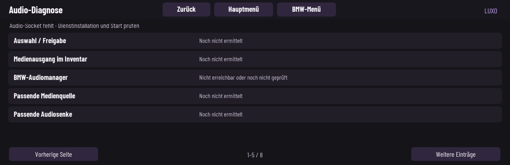

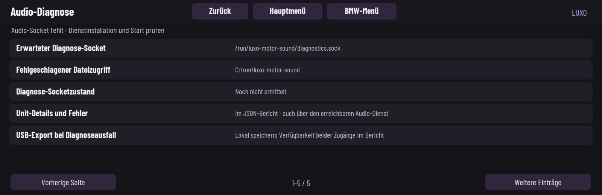

Diese Softwareaufnahme läuft auf Windows ohne Fahrzeugverbindung. Der dort sichtbare C:-Pfad ist der tatsächliche fehlgeschlagene Hostzugriff; auf der MGU wird deren tatsächlich gemeldeter Pfad angezeigt.

## Neue Klangfunktionen bedienen

Die fünf Grundprofile verwenden verschiedene Aufnahmequellen: V6, V8, ein zweiter V8-Charakter, ein Sechszylinder-Turboklang und BMW-Diesel. **Individual** bleibt frei konfigurierbar und übernimmt den dort gewählten Grundklang. Sind dieselbe Basis und identische Werte eingestellt, darf Individual entsprechend gleich klingen. Kein KI-Modell erzeugt die Audioausgabe. Die Aufnahmen werden geschnitten, gefiltert, als Schleifen überblendet und in ihrer Wiedergabegeschwindigkeit an die echte Drehzahl angepasst. Die Abstimmung ist noch kein bestätigter originalgetreuer Klang eines bestimmten BMW-Modells.

1. Profil auswählen, **Tuning → Pop & Bangs** öffnen und **Pop & Bangs ein** einschalten. Bisher gespeicherte Aus-Einstellungen bleiben beim Update absichtlich erhalten.
2. **Intensität**, **Lautstärke**, **Härte** und **Häufigkeit** getrennt einstellen. Härte verändert die Transienten und deren Wiedergabe; Häufigkeit bestimmt die Folgeimpulse nach einem erkannten Ereignis. Es läuft kein dauerhaft zufälliges Knallen ohne Fahrzeugsignal.
3. **Effekte bei echten Gangwechseln** aktivieren. **Schaltknall** benötigt zusätzlich eingeschaltete Pop & Bangs. **Schalt-Effekt: Intensität** regelt den Effektpegel. Vorwärtsgang und Signalquelle müssen tatsächlich gemeldet werden; aus Drehzahlabfällen werden keine Gänge geschätzt. Erstes Gangsignal, P/N/R, fehlende Geschwindigkeit und Stillstand lösen keinen Schalt-Effekt aus. Wiederholte Meldungen desselben Gangs lösen keinen neuen Knall aus.
4. Unter **Turbo** die Lautstärke, Intensität, Variante, Beschleunigungs-/Gaswegnahme-Anteile und **Turbo beim Schalten** anpassen. Die neue Release-Schicht und das Spulen stammen aus bearbeiteten Fahrzeugaufnahmen. Ein fehlendes Pedalsignal wird nicht künstlich ersetzt.
5. Unter **Motor** bei Bedarf **Nachklang bei Motor aus und P** einschalten und dessen Lautstärke wählen. Er läuft einmalig maximal **0,85 Sekunden**, wenn nach zuvor erkanntem Motorlauf **Motor aus, frische RPM 0, Geschwindigkeit 0 und P** vorliegen. Fehlende Werte, Bewegung, Stummschaltung oder der Aus-Schalter brechen ihn ab. Ein App-Kaltstart bei bereits abgestelltem Motor erzeugt keinen Abschlusssound.
6. **Dauerbetrieb:** Die Audiofunktion läuft unabhängig vom geöffneten Grafikmenü im vorhandenen Hintergrundteil; `autostart` bleibt aktiv. Das bedeutet Betrieb bei laufender MGU, gültiger Drehzahl und laufendem Motor. Beim Verlassen des Menüs wird die normale Soundengine nicht angehalten. Die App hält eine schlafende/abgeschaltete Head Unit nicht künstlich wach und setzt sich nicht über deren Beendigung hinweg. Langzeitbetrieb und Aufwachen sind auf deiner MGU noch zu prüfen.

Für die untenstehenden Hörproben: App-Pegel/Pegelgrenze **60 %**, Pop-Intensität **70 %**, Härte **95 %**, Häufigkeit **60 %**, Turbo **45 %**, Gaswegnahme **70 %**, Beschleunigungsanteil **65 %**. Das sind nachvollziehbare Vorschau-Einstellungen, keine beim Update erzwungene Änderung deiner gespeicherten Werte. Die allgemeinen Pegelgrenzen gelten weiterhin auch für Knall- und Schaltgeräusche.

## Abgelehnte Arbeitsproben · nicht fertiger Klang

**Diese Dateien dokumentieren den verworfenen Klangstand und werden nicht als neues fertiges Ergebnis angeboten.** Diese sechs Dateien wurden aus der **tatsächlich gebauten App-Engine** erzeugt. Die zugrunde liegenden Aufnahmequellen sind echt veröffentlichte Fahrzeugaufnahmen; der Drehzahl-/Pedal-/Gangverlauf ist ausdrücklich nur eine erfundene Hörproben-Sequenz. **Keine Live-Fahrzeugdaten und kein Nachweis von Ton aus einem BMW.** MP3 wurde für den Download aus der PCM-Ausgabe erzeugt; es gibt keine ergänzte Soundspur und keine Lautheitsnormalisierung. Bei ca. **5,5 und 17 s** liegt ein Hochschalten vor, bei **11 und 19 s** Gaswegnahme, bei **12 s** ein Herunterschalten und bei **22 s** ein bestätigter Motorstopp im Vorschau-Datensatz.

| Klangprofil | Hörprobe |
| --- | --- |
| V6 Sound | [24 Sekunden anhören/herunterladen](docs/audio/0.4.0/LUXO-0.4.0-V6.mp3) |
| V8 Sound | [24 Sekunden anhören/herunterladen](docs/audio/0.4.0/LUXO-0.4.0-V8.mp3) |
| BMW M5 F90 – Klangabstimmung | [24 Sekunden anhören/herunterladen](docs/audio/0.4.0/LUXO-0.4.0-M5-F90-Klangabstimmung.mp3) |
| BMW M Sound – Klangabstimmung | [24 Sekunden anhören/herunterladen](docs/audio/0.4.0/LUXO-0.4.0-M-Sound-Klangabstimmung.mp3) |
| Sport Diesel | [24 Sekunden anhören/herunterladen](docs/audio/0.4.0/LUXO-0.4.0-Sport-Diesel.mp3) |
| Individual – V6-Basis, tiefe Abstimmung | [24 Sekunden anhören/herunterladen](docs/audio/0.4.0/LUXO-0.4.0-Individual.mp3) |

[Hörproben-Protokoll und Prüfsummen](docs/audio/0.4.0/previews.json) · [Audioquellen, Autoren und Lizenzen](docs/audio-sources-0.4.0.md)

## Installation und Update über den MGU Store

**Bestehende GitHub-Quelle im MGU Store verwenden: Branch codex/luxo-sound-tuning-020, Update 0.4.1.** Der neue **BMW-Medienmodus** ist ausdrücklich auswählbar. Er verwendet eine verwaltete Stereo-Unterhaltungsquelle, ersetzt die Musikquelle und folgt der BMW-Lautstärke. Der bisherige separate Mischpfadmodus bleibt erhalten. **Keine universelle ID7-Freigabe; Lautsprecherausgabe und vollständiges Update im BMW noch nicht bestätigt.** [Audiopfad und Einrichtung](docs/audiopfad-0.4.0.md)

Voraussetzung ist der Community-Store [robertnisipeanu/mgu-store](https://github.com/robertnisipeanu/mgu-store), nicht der offizielle BMW ConnectedDrive Store. Die App ist für **iDrive 7** deklariert. Eine allgemeine Freigabe sämtlicher MGU-Firmwarestände besteht nicht. Der Store muss Repository-Quellen, Python-App-Builds und Tool-Abhängigkeiten unterstützen; der Dienst benötigt `mgu-python >= 1.0.2`. [Tatsächliche Store-Paketspezifikation](https://github.com/robertnisipeanu/mgu-store/blob/d878bed5ce5848d0c1ce852be23fac539e434a0b/docs/PUBLISHING.md)

1. Im BMW den **MGU Store** öffnen und die vorhandene Quelle `patryklars6/BMW-Motor-Sound-MGU-App` aktualisieren. Falls die Quelle noch fehlt: **Einstellungen → Quelle hinzufügen / Settings → Add source**, Repository-Namen eintragen.
2. Den Branch **`codex/luxo-sound-tuning-020`** auswählen. Auf `main` liegt die aktuelle Anleitung; der beauftragte App-Code liegt im Entwicklungsbranch.
3. Bei **LUXO Motor Sound** die angebotene Version **0.4.1** prüfen und **Aktualisieren** wählen. Nur bei bisher fehlgeschlagener Erstinstallation **Installieren** wählen. Eine Deinstallation ist nicht vorgesehen.
4. Der echte Store plant `mgu-python >= 1.0.2`, danach **`luxo-motor-audio >= 0.4.1`**, danach die vorhandene App. Bereits ausreichend neue Komponenten werden übersprungen. Das Audio-Paket enthält **zwei getrennte socket-aktivierte Dienste**: PCM-Ausgabe und Diagnose/USB-Export. Beide werden über das Tool-Manifest eingerichtet; keine manuelle Dienstinstallation ist vorgesehen. Die Python-Laufzeit muss bereits vorhanden oder aus einer Store-Quelle verfügbar sein, sonst verweigert der Store den Plan. Falls ausstehende Dienste gemeldet werden, den Store-Hinweis zum nächsten regulären Head-Unit-Start beachten. Keine erzwungenen Neustarts während der Fahrt.
5. Die App öffnen. Sie startet im **nativen BMW-Menü**. Unter **Audio-Diagnose** Dienstversion, Erreichbarkeit, Socket und Fehler prüfen. Die Diagnose läuft auch nach dem App-Start automatisch.
6. Bei verfügbarem kompatiblem `mgu-render/1` mit Touch-Routing **LUXO-Oberfläche** öffnen. Jede grafische Unterseite besitzt **Zurück**, **Hauptmenü** und **BMW-Menü**. Bei Renderer-Ausfall steht das native Menü als Rückfallebene bereit.

Die bisherigen Einstellungen bleiben in `data/settings.json` der App. Das Update liefert keine Ersatzdatei aus. Die App-ID und alle bisherigen Einstellungsdefinitionen bleiben erhalten; 49 ergänzende Einstellungen (48 Profilregler/Schalter und eine Aufnahme-Paketwahl) kommen ergänzend hinzu. Automatisierte Persistenztests bestehen; der vollständige Store-Updatevorgang auf deiner Head Unit steht noch aus.

**Installation ausschließlich über diese GitHub-Quelle im MGU Store.** Keine ZIP-, USB- oder manuelle Dienstinstallation.

## Neuen Audiomodus einrichten

**BMW-Menü → Audio-Diagnose → Audiomodus einrichten → BMW-Medienquelle einrichten → Diesen Medienmodus verwenden.** Dort werden die Einschränkungen vor Aktivierung gezeigt. Der Dienst prüft echte Kataloge, Quellen, Senken und PCMs, wartet auf die bestätigte Verbindung und öffnet erst danach den Ausgang. Er trennt nur die eigene Verbindung. Bei einer anderen gewählten Musikquelle stoppt er und übernimmt sie nicht automatisch wieder.

Der Modus ist **Stereo mit gemeinsamer BMW-Lautstärke**. Radio/CarPlay parallel und unabhängiger akustischer Motorsound-Pegel sind damit nicht umgesetzt. Der separate Mischpfad bleibt für tatsächlich unterstützte Hardware verfügbar. Fehlen Dienste, passende Quelle, beobachteter PCM oder geeignete Rechte, zeigt die Diagnose den Fehler. [Technik, Grenzen und Recherche](docs/audiopfad-0.4.0.md)

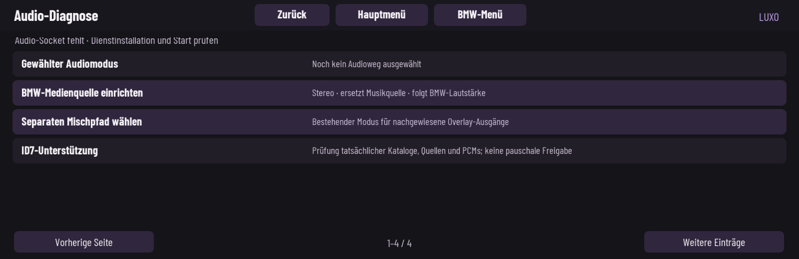

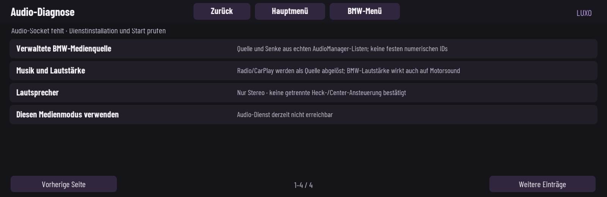

## Audio-Diagnose und erster Fahrzeugtest

1. **Audio-Diagnose → Diagnose aktualisieren** wählen. Das Menü zeigt Installation, Dienststart/Erreichbarkeit, Socket, PCM-Engine, Motor-/Profilfreigabe, Geräte, Kanalformat und Ausgabehindernis. Längere Listen über **Weitere Einträge** durchblättern.
2. **Diagnosebericht speichern** legt `diagnostics/audio-report.json` im vorhandenen App-Datenverzeichnis ab. Er enthält reale Messwerte oder ausdrücklich fehlende Daten, Softwarestände, Geräte, systemd-Ergebnisse und lesend abgefragte AudioManager-Informationen.
3. Optional **Diagnosebericht auf USB exportieren** wählen. Nur ein vom Linux-System bereits eingebundener, beschreibbarer USB-Datenträger wird angeboten. Die Datei liegt danach unter `LUXO-Diagnose/audio-…json`. Es wird nichts formatiert. In 0.4.0 übernimmt ein **separater Diagnoseprozess** den Export auch bei nicht erreichbarem PCM-Dienst. Falls beide Zugänge oder die Python-Laufzeit fehlen, bleibt nur der lokale Bericht und die ausdrücklich bezeichneten Detailfotos. Ein fehlender/beschreibgeschützter USB-Mount wird gemeldet. USB-Schreiben auf einer MGU ist noch ungetestet. In der derzeit installierten 0.3.0 existiert der zweite Zugang noch nicht; siehe [genaue Diagnoseanleitung](docs/diagnosebericht-bmw.md).
4. **Audiogeräte anzeigen / auswählen** zeigt tatsächlich von ALSA gemeldete PCMs. Sichtbarkeit beweist keine Verbindung zu RAM oder Lautsprechern. RAM-Modell und Verstärker werden ohne belegbare Daten als unbekannt geführt; deine Soundsystemauswahl ist eine Benutzervorgabe.
5. Einen Ausgang **nur dann freigeben**, wenn vor Ort bereits belegt ist, dass er ein zulässiger separater Mischpfad ist. Das Bestätigen einer Menüzeile stellt diese Route nicht her. Generische Standardgeräte, direkte Hardware-PCMs und SmartX-OEM-Quellen werden nicht automatisch als Overlay geöffnet. Ist kein geeigneter Ausgang vorhanden: Bericht exportieren. Die App richtet keine unbelegte BMW-Route ein.
6. Bei bestätigter Route den Wagen abstellen: **Motor aus, gemessene Geschwindigkeit 0, Wählhebel P**. Unbekannte Werte sperren den Test. **Leisen Stereo-Test** wählen; ein Mehrkanaltest ist nur bei entsprechend ausgewähltem Format möglich. Die App erzeugt etwa 1,5 % PCM-Peak, der Dienst begrenzt Testdaten zusätzlich auf 2 %. Das ist keine Messung der akustischen Lautstärke.
7. Auf die angezeigte Kanalfolge achten. Der Test stoppt bei geänderten/fehlenden Fahrzeugwerten, beim Verlassen der Grafik oder über **Audiotest stoppen**. **Gehörte Kanalzuordnung bestätigen** nur wählen, wenn jeder ausgegebene Kanal tatsächlich aus dem angezeigten Lautsprecherbereich gehört wurde. Die Bestätigung wird als Benutzerbeobachtung gespeichert, niemals aus erfolgreichen Schreibvorgängen abgeleitet.

Ohne freigegebenen Ausgang bleiben die Soundregler mit der PCM-Engine verbunden, die Fahrzeugausgabe bleibt gesperrt. App-Pegel und Einzelpegel verändern die eigenen Audiodaten. Eine von Radio/CarPlay unabhängige Lautstärke hinter dem BMW-Mixer wird damit **nicht** nachgewiesen. Öffentliche MGU-Tests zeigen einen Medienpfad, der Radio ersetzt und dem BMW-Pegel folgt; eine universelle parallele Overlay-Route ist nicht belegt. [Quellen, Architektur und Grenzen](docs/reparatur-0.3.0.md#audio-recherche-und-tatsächliche-grenzen)

## Menübilder · Version 0.4.1 · LUXO

Alle 27 Aufnahmen stammen aus dem gebauten **Paket 0.4.1**, durchlaufen dessen wirkliche Zeichenfunktionen und verwenden dasselbe **LUXO**-Theme: Dunkelgrau, Weiß und Violett. Sie sind Softwareaufnahmen ohne Fahrzeugverbindung; echte Live-Werte bleiben deshalb **Nicht verfügbar**. MATCH UP 10 ist als Benutzereinstellung ausgewählt. Die Diagnose zeigt den tatsächlich fehlenden Dienst auf dem Entwicklungsrechner, keine erfundene Fahrzeugverbindung. [Aufnahmeprotokoll und Bildprüfsummen](docs/screenshots/0.4.1/capture.json)

Die optionale Grafik benötigt einen kompatiblen Renderer. Die native BMW-Menüdarstellung hängt von der Head Unit ab; ein Foto davon im Fahrzeug steht aus.

### Diagnose bei fehlendem Audio-Dienst

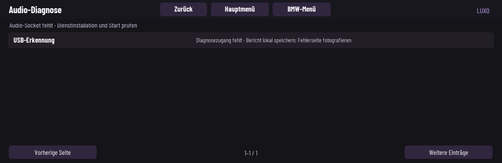

### Hauptmenü

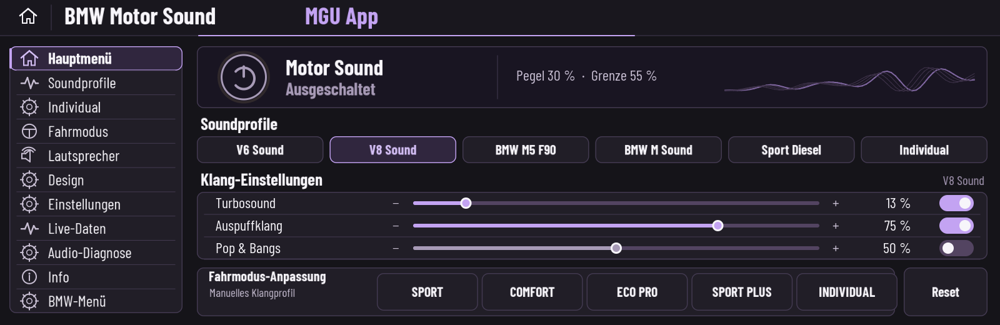


### Live-Daten

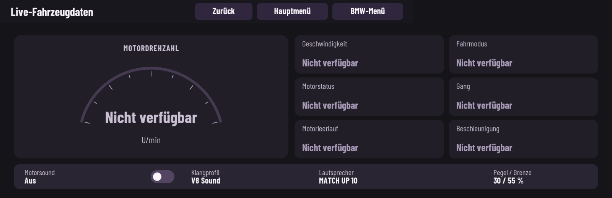


### Soundprofile

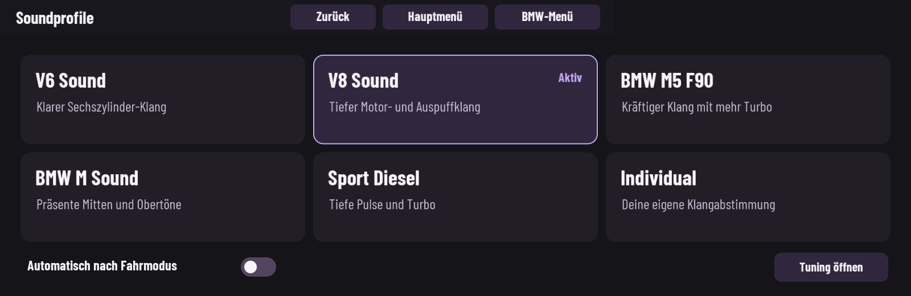


### Sound-Tuning

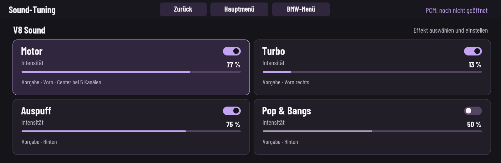


### Motor-Einstellungen

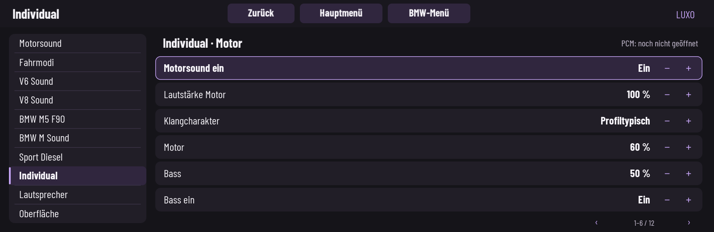


### Turbo-Einstellungen

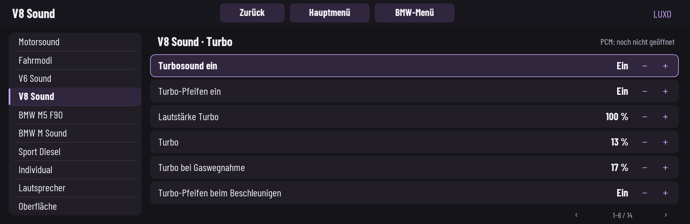


### Turbo-Varianten

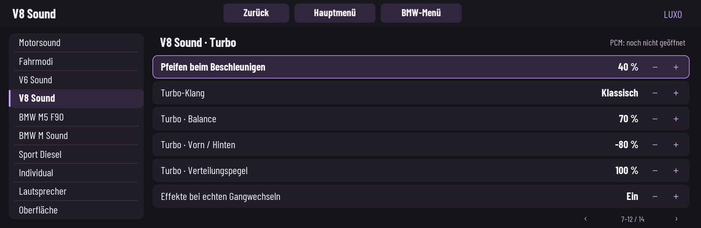


### Auspuff-Einstellungen

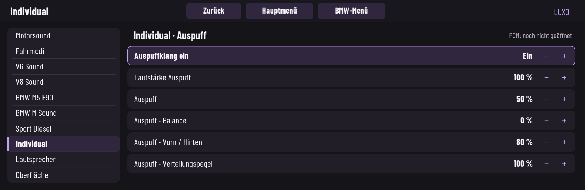


### Künstliche Pop & Bangs

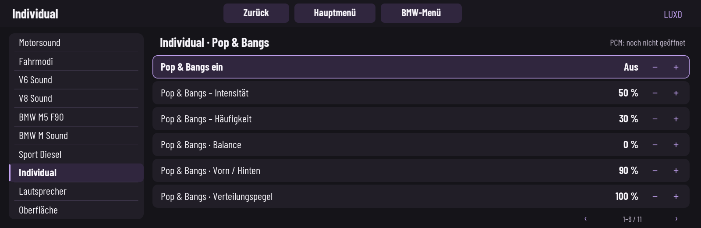


### Lautsprecher

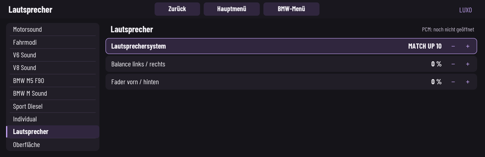


### Fahrmodi

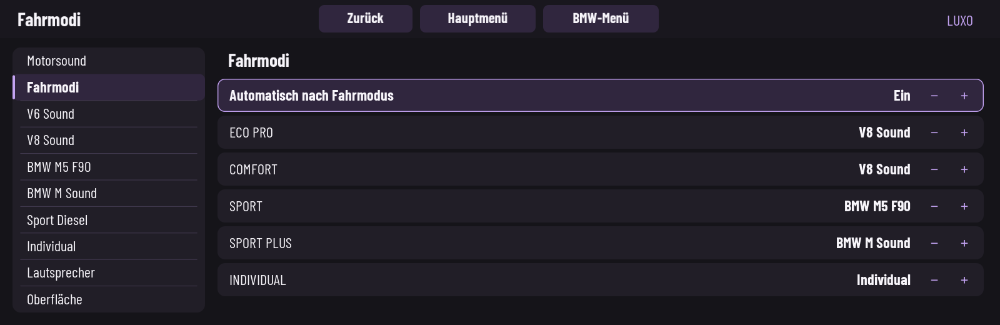


### Allgemeine Einstellungen

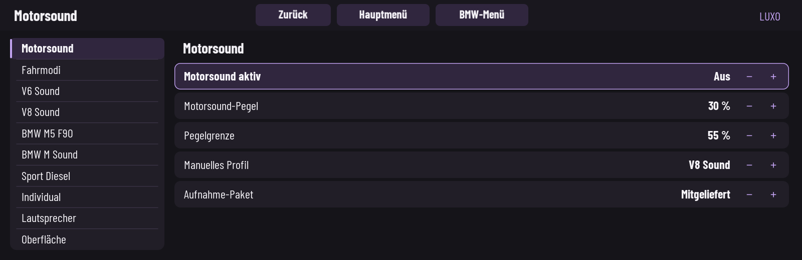


### Design

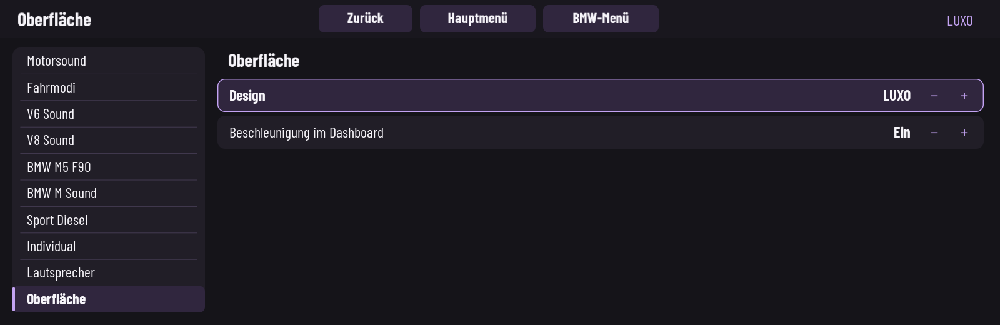


### Info und Hilfe

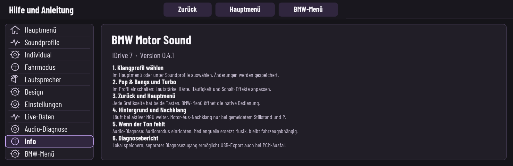


### Audio-Diagnose: Dienst und Socket

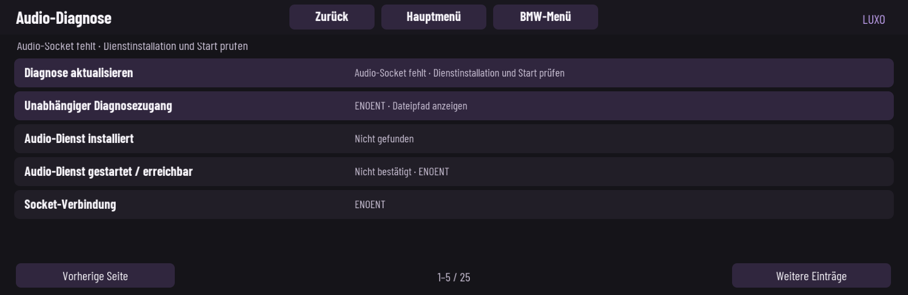


### Audio-Diagnose: Pfad und Geräte

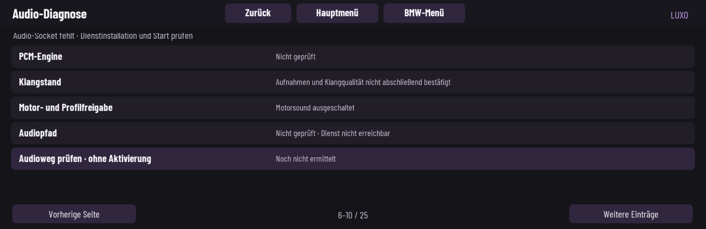


### Audio-Diagnose: Kanalformat und Grenzen

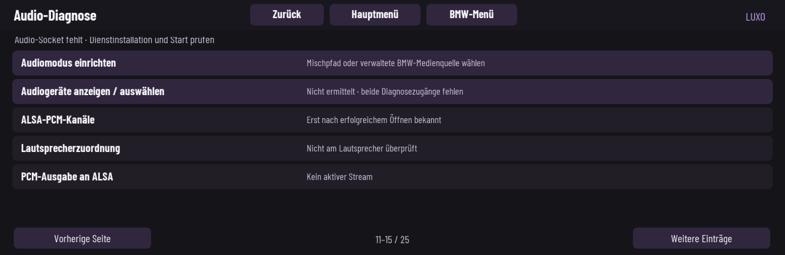


### Audio-Diagnose: gesperrte Tests und Bestätigung

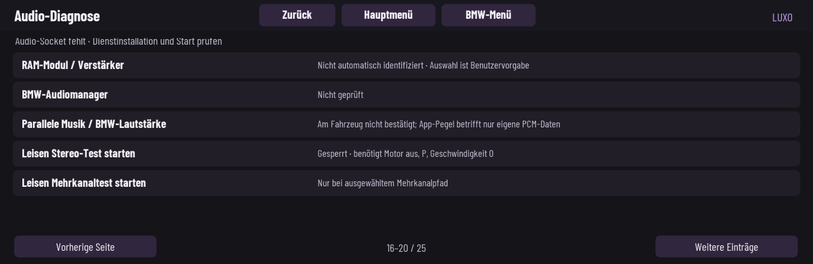


### Audio-Diagnose: Bericht und Fehler

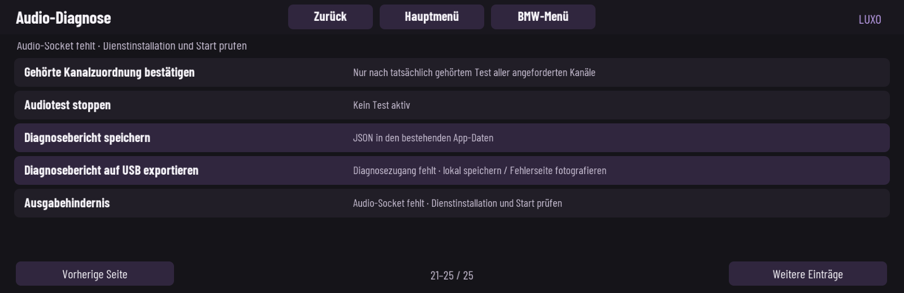

### Pop & Bangs und Schaltknall

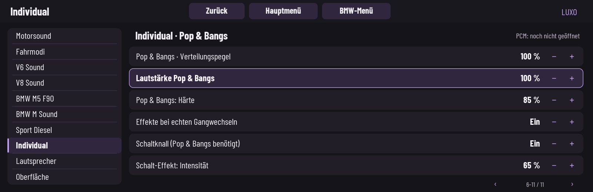

### Turbo beim Schalten

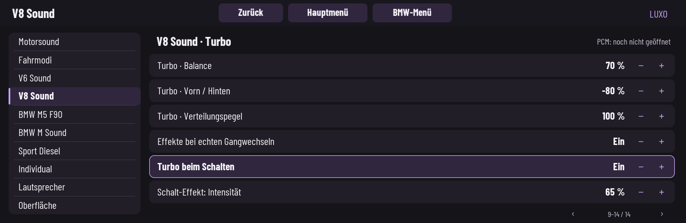

### Nachklang beim Motorabstellen

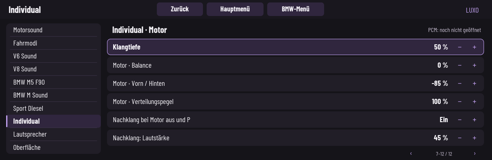

## Soundprofile und Regler

**V6 Sound**, **V8 Sound**, **BMW M5 F90**, **BMW M Sound**, **Sport Diesel** und **Individual** besitzen jeweils eigene Einstellungen. Öffne **Tuning** auf der Profilseite oder im Hauptmenü **Individual**. Die Karten **Motor**, **Turbo**, **Auspuff** und **Pop & Bangs** führen zu den jeweiligen Reglern. In den allgemeinen Einstellungen findest du alle Werte auch in der Kategorie des Profils. Bei **Individual** lässt sich zusätzlich der Grundklang wählen. Die App mischt und bearbeitet lizenzierte Fahrzeugaufnahmen abhängig von verfügbaren echten Signalen. Die BMW-Profilnamen bezeichnen Klangabstimmungen, keine bestätigten Originalaufnahmen dieser Modelle. [Quellen und Lizenzen](docs/audio-sources-0.4.0.md)

| Regler | Wirkung |
| --- | --- |
| Motorsound, Turbosound, Auspuffklang | Schaltet die jeweilige Klangschicht ein oder aus. |
| Motor, Turbo, Auspuff | Stellt die Intensität der jeweiligen Schicht ein. |
| Lautstärke Motor, Turbo, Auspuff | Regelt den eigenen Pegel jeder Schicht unabhängig vom App-Gesamtpegel. |
| Bass und Klangtiefe | Aktiviert den Tieftonanteil und regelt dessen Stärke und Gewichtung im Motor-Klang. |
| Klangcharakter | Wählt Profiltypisch, Tief, Ausgewogen, Sportlich oder M Performance. Die Auswahl verändert Obertöne, Bass und Klangstruktur. |
| Turbo-Klang und Turbo-Pfeifen | Wählt Dezent, Klassisch, Hell oder Twin-Scroll. Für Beschleunigung und Gaswegnahme gibt es separate Schalter und Intensitäten. |
| Pop & Bangs | Spielt bei passender Drehzahl und erfasster Gaswegnahme kurze bearbeitete Aufnahmen von Auspuff-Fehlzündungen. Intensität und Häufigkeit lassen sich separat ändern. Die Funktion ist anfangs ausgeschaltet. |
| Pegel und Pegelgrenze | Bestimmt die Lautstärke der Motorsound-App und begrenzt ihren maximalen Ausgangspegel. |
| Profil-Balance und Profil-Fader | Verteilt die Klangschichten links/rechts und bei geeignetem Mehrkanal-Mischpfad vorn/hinten. `Lautsprechereinstellung` übernimmt die Vorgabe des Systems. |

Änderungen werden automatisch gespeichert. **Reset** im Hauptmenü setzt die Werte des dort angezeigten Klangprofils auf seine Vorgaben zurück. Die Wahl des Lautsprechersystems und das Design bleiben erhalten.

## Lautsprecher und Fahrmodi

Das Lautsprechermenü bietet angepasste Ausgangspegel und Basswerte. Bei **Sonstiges / Aftermarket** kannst du hintere Lautsprecher, Pegel und Bass selbst angeben. Die Auswahl wird gespeichert. Unter **Tuning** hat jeder Effekt eigene Balance-, Fader- und Verteilungspegel. Negative Balancewerte verschieben nach links, positive nach rechts. Ein negativer Faderwert verschiebt nach vorn, ein positiver nach hinten. Die Voreinstellung platziert Motor vorn, Turbo vorn rechts und Auspuff sowie Pop & Bangs hinten. Center-Anteil ist nur bei einem Fünfkanal-Mischpfad einstellbar. Stereo überträgt nur links/rechts. Die Anzeige nennt die angenommenen PCM-Kanäle. Erst ein tatsächlich gehörter Kanaltest kann deren physische Zuordnung bestätigen. Die Wahl MATCH UP 10 erkennt weder den Verstärker automatisch noch schaltet sie RAM-Kanäle frei.

Der App-Pegel und seine Obergrenze gelten ausschließlich für den PCM-Strom der App. Der große Schalter im Hauptmenü schaltet ihn sofort stumm. Profilwechsel und Pegelanpassungen werden geglättet. Ob Radio, Bluetooth oder CarPlay parallel laufen und ob der BMW-Lautstärkeregler hinter dem Mischpfad beide Quellen beeinflusst, hängt von der tatsächlichen Audioarchitektur ab. [Fahrzeugtest und Mischpfad](docs/fahrzeugtest.md)

Aktiviere unter **Fahrmodus** die Automatik und wähle pro Modus ein Profil für **ECO PRO**, **COMFORT**, **SPORT**, **SPORT PLUS** und **INDIVIDUAL**. Die Zuordnung folgt dem gemeldeten BMW-Modus. Einzelne Individual-Varianten verwenden dieselbe Individual-Zuordnung. Du kannst die Automatik im Hauptmenü abschalten oder ein Profil direkt auswählen.

## Design und Dashboard

Unter **Design** wählst du **LUXO**, **M-Performance**, **Orange Sport** oder **Ice White**. Orange Sport entspricht der orangefarbenen Hauptmenü-Vorlage. Die Auswahl gilt für Hauptmenü, Live-Daten, Profile, Einstellungen und Hilfe und wird gespeichert. Ebenfalls dort kannst du die Beschleunigung im Dashboard ausblenden.

Die Drehzahlzahl zeigt den letzten real empfangenen, gerundeten Messwert. Nur der Drehzahlbogen wird zwischen empfangenen Messpunkten animiert. Mit einem kompatiblen GPU-Renderer kann die Darstellung bis zu 60 Bilder pro Sekunde erreichen. Die BMW-Menüzeilen aktualisieren sich etwa alle halbe Sekunde. Die Messrate hängt von der Head Unit ab.

## Bedienung und Fehlerbehebung

Im nativen BMW-Menü eine Zeile per Touch oder Controller öffnen, bei Reglern anschließend den Wert wählen. **Weitere Einträge / Vorherige Seite** blättert. **Zurück / Hauptmenü** führt zurück. In der Grafik verwenden Touch-Ziele und Controller denselben Seitenzustand. Die neue Kopfzeile bietet Rückweg, Hauptmenü und native Rückfallebene. BMW-Statusleisten werden nicht entfernt; die App nutzt den vom Renderer tatsächlich gemeldeten Anzeigebereich.

| Anzeige | Bedeutung und nächster Schritt |
| --- | --- |
| Audio-Dienst nicht gefunden / Socket fehlt | Dienstversion und systemd-Ergebnis in Audio-Diagnose prüfen. Store-Abhängigkeit und ausstehende Dienstaktivierung prüfen, dann Bericht speichern. |
| UID-Zugriff verweigert / PEER_DENIED | Der Dienst konnte die App-UID nicht anhand der Store-Installation bestätigen. Bericht mit UID, GID und Socketdaten exportieren. Keine pauschalen Dateirechte ändern. |
| Kein freigegebener Mischpfad | Sichtbare Geräte sind noch kein Overlay. Bericht exportieren; keinen beliebigen OEM-Ausgang freigeben. |
| Audioinventar geändert | Nach Geräte-/Firmwareänderung muss die Route vor Ort erneut geprüft werden. |
| ALSA-Öffnen fehlgeschlagen / Zeitüberschreitung | Konkreter Ausgang ist blockiert, nicht nutzbar oder unterstützt das Format nicht. Dienst trennt den Öffnungsversuch nach vier Sekunden. Bericht enthält den Fehler. |
| PCM angenommen, aber nichts hörbar | ALSA-Annahme beweist keine aktive BMW-/RAM-Route oder Lautsprecherbelegung. Keine Kanäle als gehört bestätigen; Bericht und Beobachtung weitergeben. |
| Wartet auf Fahrzeugdaten | Motorstatus und frische Drehzahl prüfen. Fehlende/ungültige Werte schalten den Sound stumm. |
| Automatik wartet auf Fahrmodus | Auf unterstütztes Signal warten oder Automatik abschalten und Profil manuell wählen. |
| Motorsound ausgeschaltet / Pegel null | Hauptschalter, App-Pegel, Pegelgrenze und einzelne Effekt-Schalter prüfen. |
| Audiotest gesperrt | Motor aus, P und exakt 0 km/h müssen tatsächlich gemeldet werden; fehlende Signale werden nicht geraten. |

## Bestätigt und noch offen

**Vom Nutzer im Fahrzeug bestätigt (0.2.2):** App-Start sowie echte Drehzahl und Geschwindigkeit auf dem genannten G31. **Automatisiert mit 0.4.0 geprüft:** Grafik-/native Aktionen, wiederholte Rücknavigation, simulierte BMW-Back-Ereignisse, Touch-Skalierung bei 1280×480 / 1440×540 / 1920×720, Renderer-Rückfall, Settings, Soundprofile und Pegelwirkung, PCM bis zur Host-Testsenke, Socketfehler und Deployer-Vorprüfung.

**Noch am Fahrzeug zu prüfen:** kompletter Store-Updatevorgang, Dienststart unter Linux, Kernel-UID-Abgleich mit der konkreten Store-Registry, tatsächliche BMW-Zurücktaste und Controller-/Touch-Routing, AudioManager-Abfragen auf dem verbauten Firmwarestand, nutzbarer Mischpfad, ALSA-Kanalformat, hörbarer Ton, Front/Heck/Center, RAM-/Verstärkerkombination, USB-Schreiben, Radio/Bluetooth/CarPlay, unabhängige akustische Lautstärke, Hintergrundbetrieb/Aufwachen und gemessene Bildrate. Auch weitere Fahrzeugfelder bleiben vom realen Anbieter abhängig. [Fahrzeugtestplan](docs/fahrzeugtest.md)

Es werden ausschließlich Fahrzeugdaten gelesen. Keine Motorsteuergeräte, Auspuffklappen oder Sicherheitsfunktionen werden verändert. AudioManager wird für die Diagnose nur lesend abgefragt; keine BMW-Medienquelle wird automatisch beansprucht.

## Paket bauen und testen

```sh
git switch codex/luxo-sound-tuning-020
python tests/run_checks.py
```

Python 3 baut die Pakete mit dem mitgelieferten iDrive-App-Kit; Node.js ab Version 20 führt die Hosttests aus. Die App zielt auf die Node.js-8-Laufzeit von iDrive 7. [App-Kit-Herkunft](vendor/README.md)

Der Test lädt fünf unveränderte Store-Dateien aus dem Commit in `tests/store_upstream.json`, prüft ihre Git-Blob-Hashes und verwendet danach den Cache unter `dist/`. Alternativ `--store-source /pfad/zum/mgu-store` mit diesem Checkout angeben. Die echte Updater-Klasse prüft die rekursive Installationsplanung (Laufzeit → Audio-Paket → App), Altversions-Update und fehlende Laufzeitquelle. Der echte Store-Packer baut den Dienst; der echte Deployer prüft `check --artifact` und `preflightApp`. Dabei zeigen seine Hardwarepfade auf ein isoliertes Host-Verzeichnis. OEM-SDK-Verknüpfung, MainApp-Installation, systemd-Start und Fahrzeugaudio werden dadurch nicht getestet.


## Freigabestand

Der technische Audioweg im Nutzerfahrzeug ist noch nicht bestätigt. „Audiopfad fehlt“ allein trennt fehlenden Dienst, Socketfehler und fehlende Route nicht. [Benötigter Fahrzeugbericht](docs/diagnosebericht-bmw.md) · [Kompatibilitätsmatrix](docs/kompatibilitaet-0.4.0.md) · [Optionale Soundpakete](docs/soundpacks.md). Ein neuer Klang und erfolgreiche Hosttests sind keine vollständige Reparatur der BMW-Lautsprecherausgabe.


Der zusätzliche dreiminütige Echtzeittest ohne gestartete Oberfläche nahm 179,98 s PCM an (8999 nichtleere Blöcke); größte Host-Blocklücke 47 ms. [Messbericht](docs/validation/headless-endurance-0.4.0.json). Diese Messung ist keine Lautsprecherprüfung.
