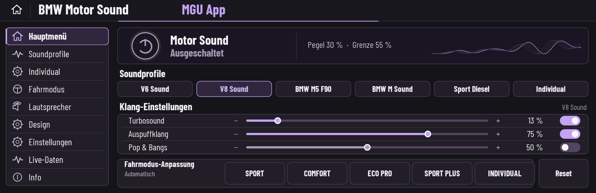
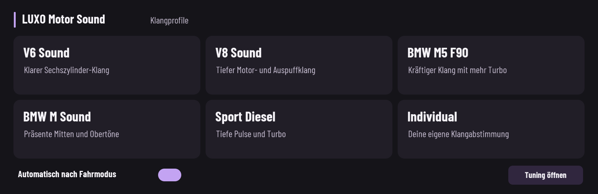
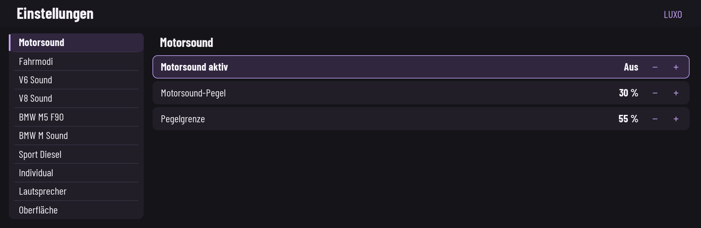

# BMW Motor Sound MGU App

LUXO Motor Sound ergänzt BMW-MGU-Head-Units mit iDrive 7 um ein Motorsound-Menü und ein Dashboard für verfügbare Fahrzeugdaten. Version **0.2.0** ist für den Fahrzeugtest vorbereitet.

## Installation über den MGU Store

Diese Anleitung gilt für den Community-MGU-Store auf BMW-MGU-Head-Units mit **iDrive 7**. Sie setzt voraus, dass der MGU Store bereits installiert ist, sich öffnen lässt und Internetzugang hat. [Dokumentation zum MGU Store](https://github.com/robertnisipeanu/mgu-store#readme)

### 1. GitHub-Quelle hinzufügen

1. Öffne den **MGU Store** in deinem BMW.
2. Wähle **Einstellungen → Quelle hinzufügen**. Bei englischer Sprache steht dort **Settings → Add source**.
3. Gib den Namen des öffentlichen GitHub-Projekts ein.

   ```text
   patryklars6/BMW-Motor-Sound-MGU-App
   ```

4. Wähle in der angezeigten Kanalauswahl den passenden Branch.

   | Welche Version möchtest du installieren? | Branch im MGU Store |
   | --- | --- |
   | **0.2.0** mit der neuen LUXO-Oberfläche, sechs Klangprofilen und Sound-Tuning | `codex/luxo-sound-tuning-020` |
   | **0.1.1** vom Hauptbranch, solange die Testversion im Pull Request liegt | `main` |

   Die Version 0.2.0 liegt in [Pull Request #1](https://github.com/patryklars6/BMW-Motor-Sound-MGU-App/pull/1). Für öffentliche GitHub-Quellen ist normalerweise keine GitHub-Anmeldung nötig.

### 2. App installieren

1. Lass den Store die gewählte Quelle laden. Aktualisiere die Quelle im Store, falls die App noch nicht angezeigt wird.
2. Wähle **LUXO Motor Sound** und prüfe im Store, ob die gewünschte Versionsnummer angezeigt wird.
3. Wähle **Installieren** bzw. **Install**. Der Store lädt die Dateien aus dem gewählten Branch und baut die App auf deiner Head Unit. Wenn der Store einen weiteren Schritt anzeigt, folge seiner Meldung. [So verarbeitet der MGU Store einen GitHub-Branch](https://github.com/robertnisipeanu/mgu-store/blob/main/docs/PUBLISHING.md#3-repo-tree)
4. Öffne **LUXO Motor Sound** anschließend aus der iDrive-App-Liste. In Version 0.2.0 findest du die Versionsnummer auch unter **Info** im Hauptmenü.

### 3. Erster Start mit Version 0.2.0

1. Öffne **Live-Daten** und prüfe im Stand, ob Drehzahl und Motorstatus angezeigt werden. Fehlende Werte erscheinen als **Nicht verfügbar**.
2. Wähle unter **Lautsprecher** dein System, zum Beispiel **MATCH UP 10**, und unter **Soundprofile** den gewünschten Klang.
3. Stelle unter **Einstellungen → Motorsound** zuerst einen niedrigen Pegel und eine Obergrenze ein. Der Motorsound ist bei der ersten Einrichtung ausgeschaltet. Einschalten kannst du ihn über den großen Schalter im Hauptmenü.

Die Installation im Fahrzeug steht noch zur Prüfung aus. Für hörbaren Motorsound braucht die App zusätzlich einen bestätigten Audiomischpfad. Bis dahin kann die App **Audiopfad nicht verfügbar** anzeigen. [Fahrzeugtest und Audiopfad](docs/fahrzeugtest.md)

### Wenn du nicht weiterkommst

| Was siehst du? | Was kannst du prüfen? |
| --- | --- |
| Die Quelle lässt sich nicht laden | Prüfe den Internetzugang des Stores und die Schreibweise des Repository-Namens. |
| Die App erscheint als 0.1.1 | Prüfe den gewählten Branch. Für 0.2.0 verwende `codex/luxo-sound-tuning-020`. |
| Der Store meldet einen Paketbaufehler | Prüfe die Detailmeldung im Store. Für diesen Branch benötigt der Store seinen Python-Build-Support `mgu-python`. |
| Die App öffnet sich, aber es kommt kein Ton | Prüfe den Motorsound-Schalter und die Meldung zum Audiopfad. |

## Menüs im LUXO-Design

Alle Bilder zeigen dieselbe Einstellung **LUXO** mit dunkelgrauem Hintergrund und violetten Akzenten. Die Vorschauen stammen aus dem ID7-Paket 0.2.0. In der Live-Ansicht fehlen Messwerte, weil bei der Aufnahme keine Fahrzeugverbindung bestand.

### Hauptmenü



### Live-Daten


### Soundprofile



### Sound-Tuning


### Turbo-Einstellungen


### Lautsprecher


### Fahrmodi


### Allgemeine Einstellungen



### Design


### Info und Hilfe


[ID7-Paket 0.2.0 herunterladen](packages/patryklars6_motor_sound@0.2.0.tgz)

Im **Lautsprecher**-Menü stehen Standard, BMW HiFi, Harman Kardon, Bowers & Wilkins, MATCH UP 8, MATCH UP 10 und Sonstiges / Aftermarket zur Auswahl.

Auf einem kompatiblen GPU-Renderer kannst du die Karten und Direktregler auf der Oberfläche bedienen. Die iDrive-Tasten bieten die entsprechenden Aktionen für das native RHMI. In den Einstellungen wählst du mit **Menü** die Kategorie und mit **Zeile** den Regler. **Wert −** und **Wert +** ändern seinen Wert.

## Soundprofile und Regler

**V6 Sound**, **V8 Sound**, **BMW M5 F90**, **BMW M Sound**, **Sport Diesel** und **Individual** besitzen jeweils eigene Einstellungen. Öffne **Tuning** auf der Profilseite oder im Hauptmenü **Individual**. Die Karten **Motor**, **Turbo**, **Auspuff** und **Pop & Bangs** führen zu den jeweiligen Reglern. In den allgemeinen Einstellungen findest du alle Werte auch in der Kategorie des Profils. Bei **Individual** lässt sich zusätzlich der Grundklang wählen. Die App erzeugt die Klänge selbst.

| Regler | Wirkung |
| --- | --- |
| Motorsound, Turbosound, Auspuffklang | Schaltet die jeweilige Klangschicht ein oder aus. |
| Motor, Turbo, Auspuff | Stellt die Intensität der jeweiligen Schicht ein. |
| Lautstärke Motor, Turbo, Auspuff | Regelt den eigenen Pegel jeder Schicht unabhängig vom App-Gesamtpegel. |
| Bass und Klangtiefe | Aktiviert den Tieftonanteil und regelt dessen Stärke und Gewichtung im Motor-Klang. |
| Klangcharakter | Wählt Profiltypisch, Tief, Ausgewogen, Sportlich oder M Performance. Die Auswahl verändert Obertöne, Bass und Klangstruktur. |
| Turbo-Klang und Turbo-Pfeifen | Wählt Dezent, Klassisch, Hell oder Twin-Scroll. Für Beschleunigung und Gaswegnahme gibt es separate Schalter und Intensitäten. |
| Pop & Bangs | Spielt bei passender Drehzahl und erfasster Gaswegnahme kurze synthetische Impulse. Intensität und Häufigkeit lassen sich separat ändern. Die Funktion ist anfangs ausgeschaltet. |
| Pegel und Pegelgrenze | Bestimmt die Lautstärke der Motorsound-App und begrenzt ihren maximalen Ausgangspegel. |
| Profil-Balance und Profil-Fader | Verteilt die Klangschichten links/rechts und bei geeignetem Mehrkanal-Mischpfad vorn/hinten. `Lautsprechereinstellung` übernimmt die Vorgabe des Systems. |

Änderungen werden automatisch gespeichert. **Reset** im Hauptmenü setzt die Werte des dort angezeigten Klangprofils auf seine Vorgaben zurück. Die Wahl des Lautsprechersystems und das Design bleiben erhalten.

## Lautsprecher und Fahrmodi

Das Lautsprechermenü bietet angepasste Ausgangspegel und Basswerte. Bei **Sonstiges / Aftermarket** kannst du hintere Lautsprecher, Pegel und Bass selbst angeben. Die Auswahl wird gespeichert. Unter **Tuning** hat jeder Effekt eigene Balance-, Fader- und Verteilungspegel. Negative Balancewerte verschieben nach links, positive nach rechts. Ein negativer Faderwert verschiebt nach vorn, ein positiver nach hinten. Die Voreinstellung platziert Motor vorn, Turbo vorn rechts und Auspuff sowie Pop & Bangs hinten. Center-Anteil ist nur bei einem Fünfkanal-Mischpfad einstellbar. Stereo überträgt nur links/rechts. Die Anzeige im Tuning und Lautsprechermenü nennt die aktuell gemeldeten PCM-Kanäle.

Der App-Pegel und seine Obergrenze gelten ausschließlich für den PCM-Strom der App. Der große Schalter im Hauptmenü schaltet ihn sofort stumm. Profilwechsel und Pegelanpassungen werden geglättet. Ob Radio, Bluetooth oder CarPlay parallel laufen und ob der BMW-Lautstärkeregler hinter dem Mischpfad beide Quellen beeinflusst, hängt von der tatsächlichen Audioarchitektur ab. [Fahrzeugtest und Mischpfad](docs/fahrzeugtest.md)

Aktiviere unter **Fahrmodus** die Automatik und wähle pro Modus ein Profil für **ECO PRO**, **COMFORT**, **SPORT**, **SPORT PLUS** und **INDIVIDUAL**. Die Zuordnung folgt dem gemeldeten BMW-Modus. Einzelne Individual-Varianten verwenden dieselbe Individual-Zuordnung. Du kannst die Automatik im Hauptmenü abschalten oder ein Profil direkt auswählen.

## Design und Dashboard

Unter **Design** wählst du **LUXO**, **M-Performance**, **Orange Sport** oder **Ice White**. Orange Sport entspricht der orangefarbenen Hauptmenü-Vorlage. Die Auswahl gilt für Hauptmenü, Live-Daten, Profile, Einstellungen und Hilfe und wird gespeichert. Ebenfalls dort kannst du die Beschleunigung im Dashboard ausblenden.

Die Drehzahlzahl zeigt den letzten real empfangenen, gerundeten Messwert. Nur der Drehzahlbogen wird zwischen empfangenen Messpunkten animiert. Mit einem kompatiblen GPU-Renderer kann die Darstellung bis zu 60 Bilder pro Sekunde erreichen. Im nativen RHMI zielt die Live-Ansicht auf bis zu 12 Bilder pro Sekunde. Die Messrate hängt von der Head Unit ab.

## Fehlerbehebung und Fahrzeugtest

| Anzeige | Prüfung |
| --- | --- |
| Nicht verfügbar | Unter Live-Daten prüfen, ob die MGU das betroffene Signal liefert. Fehlende und ungültige Werte werden als solche angezeigt. |
| Wartet auf Fahrzeugdaten | Motorstatus und Drehzahl in der Live-Ansicht prüfen. Bei unbekanntem oder veraltetem Drehzahlsignal bleibt der Sound stumm. |
| Wartet auf Fahrmodus | Prüfen, ob der BMW einen unterstützten Modus liefert. Alternativ ein Klangprofil manuell wählen. |
| Audiopfad nicht verfügbar | Für den Motorsound ist eine auf der konkreten MGU bestätigte parallele Mischroute erforderlich. Die App beansprucht keine Medienquelle. |
| Stumm | App-Pegel, Pegelgrenze und Schalter der Klangschichten prüfen. |

Eine Installation und ein vollständiger Audiotest im BMW G31 530d mit MATCH UP 10 stehen aus. Die gleichzeitige Wiedergabe mit Radio, Bluetooth und CarPlay ist auf der Serien-MGU bisher nicht bestätigt. Auch Autostart, Hintergrundbetrieb, tatsächlich verfügbare Fahrzeugfelder und physische Kanalzuordnung brauchen einen Fahrzeugtest. Der [Fahrzeugtestplan](docs/fahrzeugtest.md) beschreibt die Prüfung und die optionale ALSA-Brücke.

## Paket bauen und testen

```sh
python tools/build_store.py
node --test tests/runtime.test.js
python -m unittest discover -s tests -p test_bridge.py
python tests/verify_package.py dist/patryklars6_motor_sound@0.2.0.tgz
```

Der Paketbau nutzt Python 3 und das mitgelieferte iDrive-App-Kit. Die Hosttests nutzen Node.js ab Version 20. Die App-Laufzeit zielt auf die Node.js-8-Umgebung des iDrive 7. [Herkunft des App-Kits](vendor/README.md)
