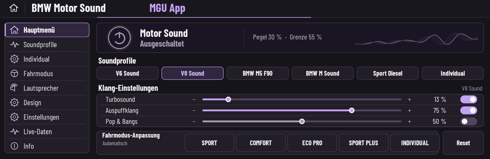
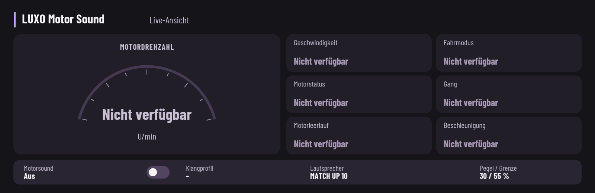
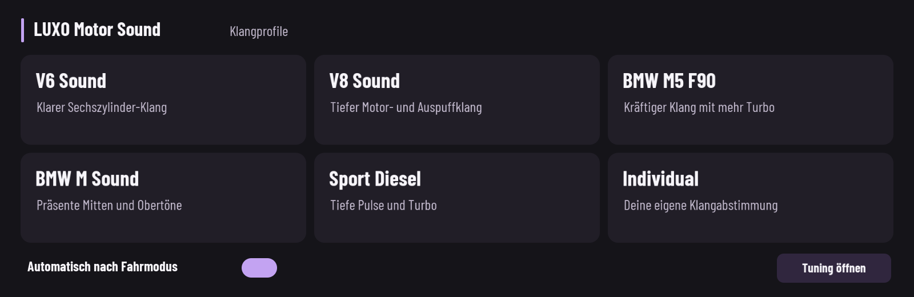
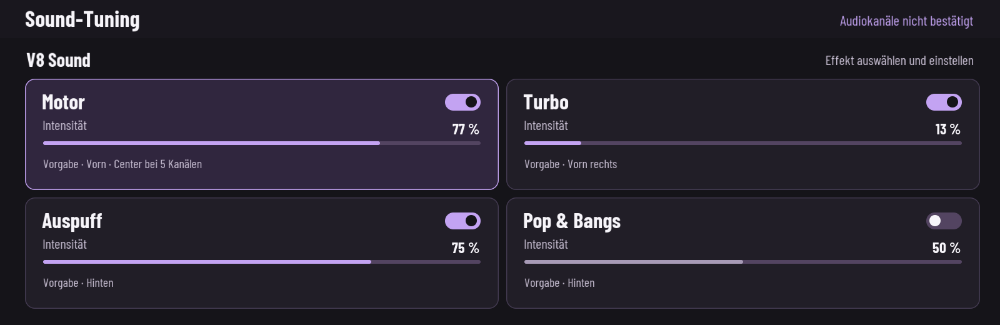
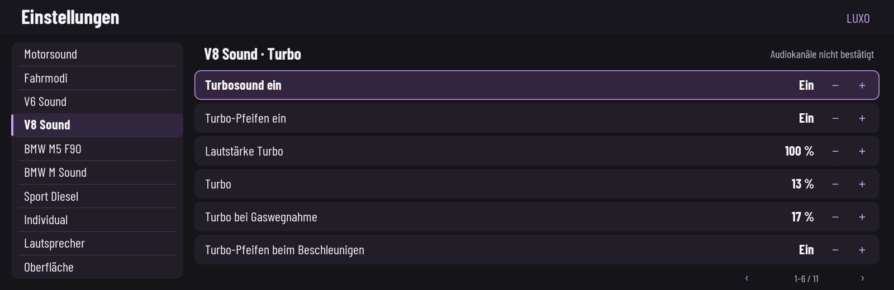
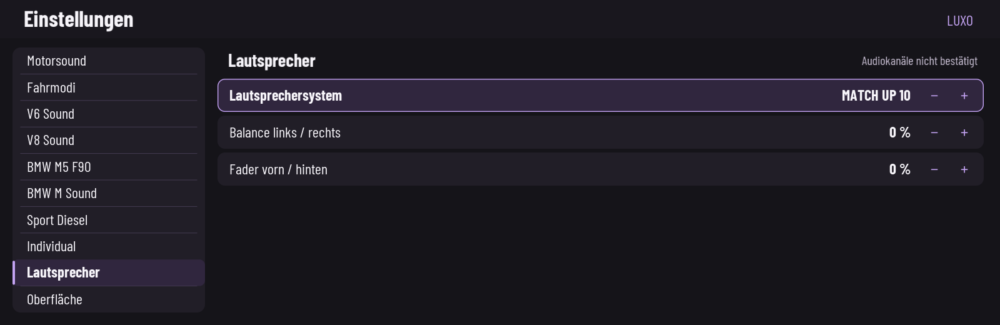
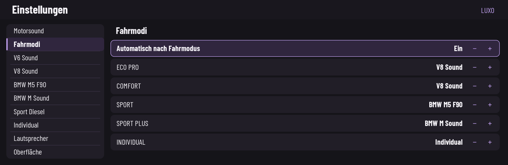
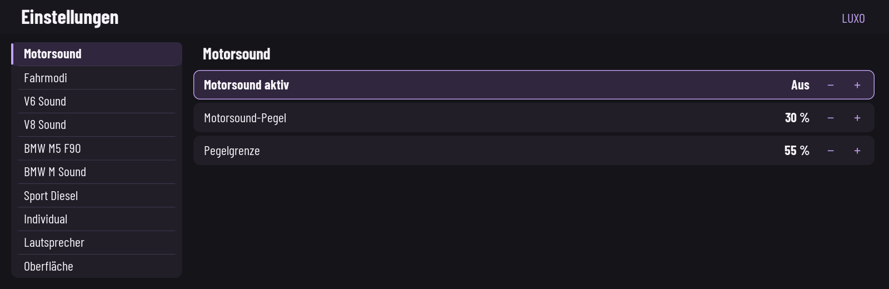
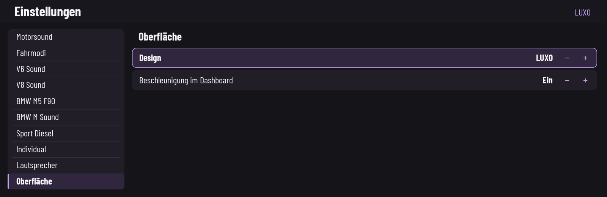
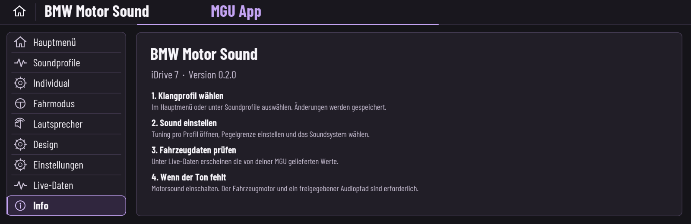

# Menüs im LUXO-Design

Alle Bilder zeigen dieselbe Einstellung **LUXO** mit dunkelgrauem Hintergrund und violetten Akzenten. Die Vorschauen stammen aus dem ID7-Paket 0.2.0. In der Live-Ansicht fehlen Messwerte, weil bei der Aufnahme keine Fahrzeugverbindung bestand.

[Installation im MGU Store](installation-mgu-store.md)

## Hauptmenü

## Live-Daten

## Soundprofile

## Sound-Tuning

## Turbo-Einstellungen

## Lautsprecher

## Fahrmodi

## Allgemeine Einstellungen

## Design

## Info und Hilfe

